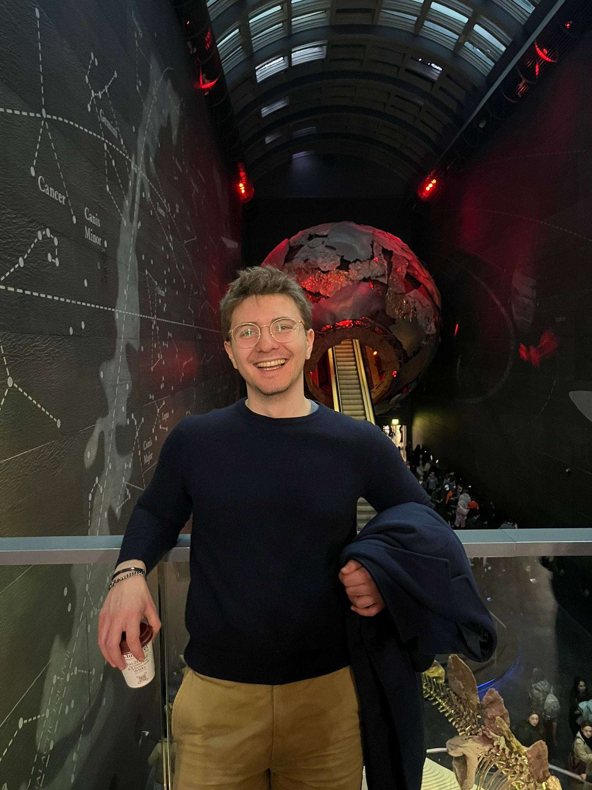

  

    
I'm <strong>Alessandro Sanvito</strong>, a Software Engineer at <strong>Optiver</strong> in Amsterdam. I work in the Quantitative Volatility Strategies team, building systematic options strategies and the data infrastructure behind them.

    
Before Optiver, I was an AI Research Intern at <strong>Mercedes-Benz</strong> in Böblingen, where I researched neural scene representations for autonomous driving, from reconstructing scenes through fog to complete 3D human avatars from limited viewpoints. That work led to papers at <a href="/publications/">ICCV and IEEE IV</a>.

    
I hold dual master's degrees from <strong>KTH Royal Institute of Technology</strong> (ICT Innovation, Data Science) and <strong>Politecnico di Milano</strong> (Computer Science and Engineering, 110/110 cum laude).

  

  

    
  

## What I work with

At Optiver I build baseline systematic strategies for new product groups and the data pipelines that feed them: Python, Spark, Polars, and DuckDB over 10+ TB of instrument-level data, plus ML model training on AWS. I work closely with quant researchers, who take those baselines and optimize them for alpha.

My ML background spans deep learning (PyTorch, TensorFlow) with a focus on computer vision and generative models, plus classical ML with scikit-learn, CatBoost, and XGBoost.

## Get in touch

Find me on [LinkedIn](https://www.linkedin.com/in/alessandro-sanvito/) and [GitHub](https://github.com/Alexdruso), or download my [CV](/public/Alessandro_Sanvito_CV.pdf).
